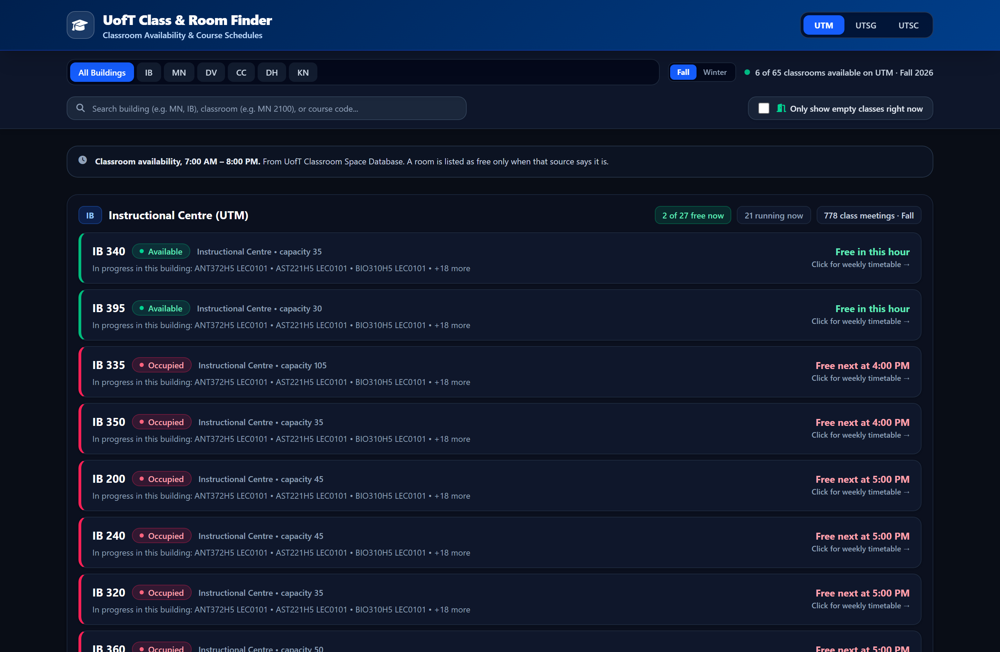
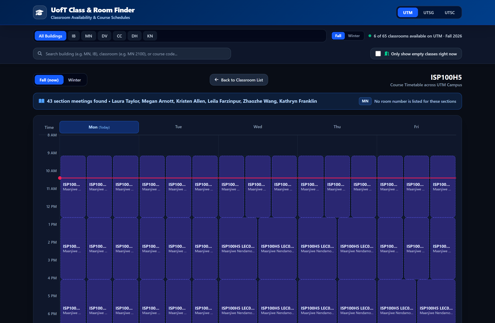
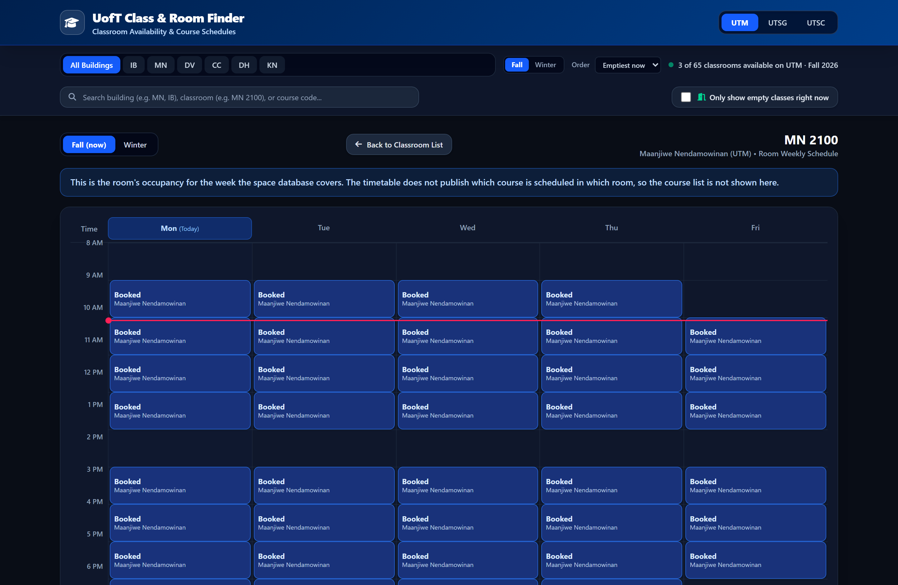
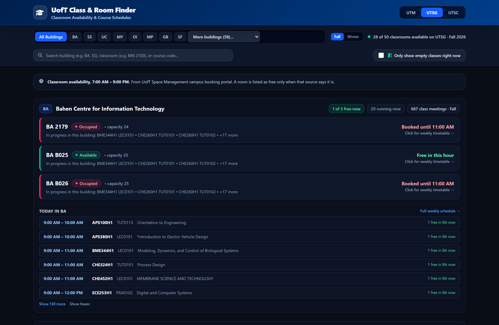

<div align="center">

# UofT Class & Room Finder

**Find University of Toronto classes and empty classrooms — and never be told a
room number that the University has not published.**

[](https://nextjs.org)
[](https://react.dev)
[](https://tailwindcss.com)
[](https://python.org)
[](#testing)
[](LICENSE)

</div>

---

## Screenshots

**Classroom list** — every UTM classroom with its real availability from the
UofT Classroom Space Database, plus the classes running in each building.



**Course timetable** — every section of a course across the week.



**Classroom timetable** — a single room's occupancy for the snapshot week.



**St. George** — building-level class schedules, with 68 buildings kept
tidy behind a compact picker.



---

## Reading further

- **[docs/REPORT.md](docs/REPORT.md)** — the project report: the problem, the
  room-number finding, the method, the filter funnel, the evaluation, and
  the limitations.
- **[docs/ARCHITECTURE.md](docs/ARCHITECTURE.md)** — how it is put together
  and why.

---

## What it does

- **Complete course schedules** for Fall 2026 and Winter 2027 — 7,383 course
  records, 21,408 class meetings, all 8 faculties, 3 campuses.
- **Real classroom availability** for UTM, from the official UofT Classroom
  Space Database: 65 actual rooms, per-hour occupancy, real capacity.
- **Search** by course code, building or classroom.
- **Weekly timetables** for a course, a building or a single classroom.
- A **Fall / Winter** switch, so you can see one term or the whole year.
- A payload of **87 KB** for the first screen - the dataset is split per
  campus and served compressed, so the browser only downloads the campus it
  is about to show.

| | |
|---|---|
| Class meetings | 21,408 across 7,383 course rows, 8 faculties, 3 campuses |
| Classrooms | 65 real UTM classrooms with published per-hour occupancy |
| Invented values | **0** |
| First load | **87 KB** (was 8.3 MB) |
| Tests | 99 across three layers, plus 4 automated accessibility checks |

## The part that matters: it does not make things up

The UofT timetable API publishes **no room numbers**. Not "a few missing" —
none. Across all 22,659 meeting times in the 2026-27 sessions, the
`buildingRoomNumber` field is an empty string.

An earlier version of this project guessed them anyway, from a hard-coded
table of plausible room numbers, and shipped rooms that no class was ever
scheduled in. This version deletes that code. Where the source publishes
nothing, the interface says so:

> **Room not published**

The same rule applies everywhere:

| Thing | What the app does |
|---|---|
| A class with no published room | Shows the building and "room not published" |
| An hour the space database omits (13:00) | Shows **unknown**, never "free" |
| A building with no published name | Shows "Name not listed" |
| A campus with no classroom data | Says so, and shows building-level schedules instead |

Classroom availability is a **dated snapshot**, not a live feed, and the
interface says that too — in a banner, once, rather than repeating it on
every card.

## Quick start

```bash
npm install
npm run dev          # http://localhost:3000
```

The dataset is committed, so the app runs immediately — no scraping needed.

The Python side (scraper):

```bash
cd scraper
uv sync
uv run pytest
```

> **On Windows:** `node_modules` is a Windows install, so run npm, Next and
> uv through `cmd.exe`. Running them from WSL fails on a missing native
> binary.

## The data pipeline

The interesting bug in this project was a silent one.

`getPageableCourses` **ignores the `pageSize` you send** and always returns
20 rows per page. The previous scraper computed the page count from the page
size it had *requested*:

```
ceil(7383 / 50) = 148 pages fetched     ← but 370 pages exist
```

It wrote 2,960 of 7,383 course rows — 40% of the catalogue — and reported
success. Your own class was in the missing 60%.

The rewrite derives the page count from the rows it actually receives,
asserts `fetched == total`, detects duplicate rows, and **fails loudly**
rather than writing a partial dataset. There is a regression test for
exactly this.

```
course rows fetched : 7383 (expected 7383)
class meetings      : 21408
rooms in inventory  : 65
published rooms     : 0 (the UofT API publishes none for these sessions)
divisions covered   : APSC, ARCLA, ARTSC, ERIN, FIS, FPEH, MUSIC, SCAR
```

The dataset is written one file per campus key, and `data:verify` checks
that those files add up to the totals in `meta.json` exactly:

| Campus key | Meetings | On disk | Over the wire (gzipped) | In the UI |
|---|---:|---:|---:|---|
| `UTM` | 5,178 | 2.1 MB | **87 KB** | yes (the default) |
| `UTSG` | 12,175 | 4.8 MB | 231 KB | yes |
| `UTSC` | 3,961 | 1.5 MB | 69 KB | yes |
| `SHERIDAN` | 94 | 36 KB | 2 KB | no tab - as before |
| **Total** | **21,408** | **8.4 MB** | **389 KB** | |

### Where the numbers come from

| Source | Endpoint |
|---|---|
| Course catalogue | `POST https://api.easi.utoronto.ca/ttb/getPageableCourses` |
| Faculties | `GET https://api.easi.utoronto.ca/ttb/getMatchingDivisions` |
| UTM classroom space | `https://metis.utm.utoronto.ca/` (snapshot committed in `data/`) |
| Building names | [`cobalt-uoft/datasets`](https://github.com/cobalt-uoft/datasets) — U of T's own open-data project |

Building names from Cobalt were only accepted when the campus Cobalt records
for a building **matches the campus of the timetable classes that meet
there** — Cobalt's code space collides with the timetable's, and a blind
import would have labelled `MN` as a St. George building. Every name in
`data/building_names.json` carries its source.

## Architecture

```
src/
  app/
    layout.tsx              # shell, metadata, Font Awesome
    page.tsx                # server component -> <ClassFinder />
    globals.css             # Tailwind v4 + the dark theme
    api/schedule/[campus]/  # one gzipped payload per campus
  components/
    ClassFinder.tsx         # client component: state, routing, list view
    WeeklySchedule.tsx      # the weekly grid
    lib/
      schedule.ts           # pure logic - no browser APIs, fully unit-tested
      types.ts              # shared types
scraper/
  src/uoft_scraper/
    api.py                  # TTB client: pagination, retries, completeness checks
    parse.py                # raw rows -> class meetings
    metis.py                # space database -> rooms + occupancy
    build.py                # assembly + provenance, split per campus
    cli.py                  # `build` and `verify`
  tests/                    # 39 pytest tests + committed API fixtures
tests/
  unit/                     # 45 Vitest tests
  e2e/                      # 15 Playwright tests
data/
  campus/<KEY>.json         # the dataset, one file per campus key
  rooms.json                # the UTM classroom inventory
  meta.json                 # provenance and the invariants the split must match
```

Three decisions worth calling out:

**The dataset is stored one file per campus.** The catalogue is 8.3 MB of
JSON, and the app only ever shows one campus at a time. Serving the whole
thing cost 8.3 MB before the first pixel; the default campus now costs
**87 KB over the wire** - a hundredfold difference - and St. George, which
is the biggest of the four, costs 231 KB. `npm run data:size` measures the
gzipped size of each payload and fails the build if the default campus
crosses 150 KB, so the win cannot quietly be given back.

**Everything that can be a pure function is one.** Time handling, term
filtering, search, room-availability states and the timetable layout all live
in `src/components/lib/schedule.ts`, which touches no browser API. That is
why 45 of the 99 tests are fast and deterministic.

**The data is verified, not trusted.** `npm run data:verify` re-checks the
committed dataset's invariants - that the per-campus files add up to the
totals in `meta.json`, that no meeting carries a room the source did not
publish, that there are no duplicates. It runs in CI.

## Testing

```bash
npm run scraper:test   # 39 pytest  - saved API fixtures, no network
npm test               # 45 Vitest  - pure logic + React components
npm run test:e2e       # 15 Playwright - against the production build
npm run data:verify    # the committed dataset's invariants
npm run data:size      # the gzipped payload budget
```

| Layer | What it protects |
|---|---|
| **pytest** | The data contract: pagination completeness, the course-code and session rules, cancelled sections, the Metis weekday derivation, the missing 13:00 hour, the per-campus split |
| **Vitest** | The app: time handling, term filtering, search, room availability states, the timetable layout, and the components — including "no invented room numbers" |
| **Playwright** | The shipped product: campus tabs, course search, the weekly timetable, the classroom view, the API payload, keyboard operation |

**No test touches the network.** Every fixture is committed.

### Accessibility

The target is **WCAG 2.1 AA**, and it is checked rather than claimed:
`@axe-core/playwright` runs against the classroom list, a course timetable, a
classroom timetable and St. George, and the build fails on any violation.

That took real fixes. The room cards, the timetable blocks and the logo were
`<div onClick>` — clickable, but invisible to the keyboard and to a screen
reader. They are buttons now, with an accessible name and a visible focus
ring. The muted grey used for secondary text was 3.8:1 against the panel
background, under the 4.5:1 that AA requires; it is 7.1:1 now. The weekly
grid scrolls sideways on a narrow screen, so it is focusable and labelled
rather than a trap for keyboard users.

This is automated coverage, not an external audit: a machine cannot judge
whether the wording makes sense.

## Commands

| Command | What it does |
|---|---|
| `npm run dev` | Development server |
| `npm run build` | Production build |
| `npm run lint` | ESLint |
| `npm test` | Vitest |
| `npm run test:e2e` | Playwright |
| `npm run scraper:test` | pytest |
| `npm run data:build` | Re-fetch the timetable and rewrite `data/` |
| `npm run data:verify` | Check the committed dataset's invariants |
| `npm run data:size` | Check the gzipped payload against the budget |
| `npm run screenshots` | Re-capture the images in `docs/images/` |

## Data and attribution

Class schedules come from the University of Toronto's public Timetable Builder
API; classroom availability comes from U of T's Classroom Space Database;
building names come from Cobalt, U of T's open-data project.

The University of Toronto publishes **no terms of use, rate-limit statement
or versioning policy** for the timetable API. The API is read at a polite
pace, by hand, and the result is committed as a dated snapshot so the app
does not hit U of T's servers on every visit.

This project is **not affiliated with or endorsed by the University of
Toronto**.

## License

MIT — see [LICENSE](LICENSE). The data in `data/` is a redistributed
snapshot of public University information and is not covered by that licence.
