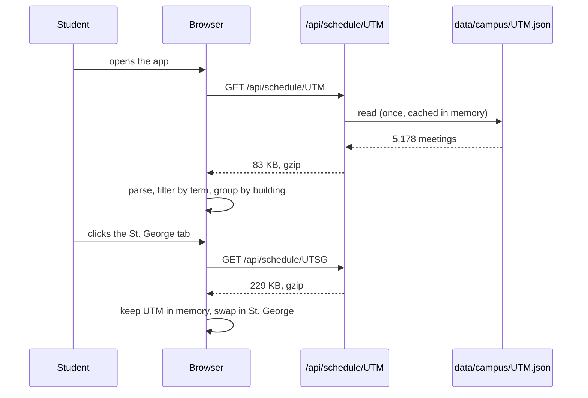

# Architecture

How the project is put together, and why each piece is where it is.

---

## 1. The shape of it

```
┌───────────────────────────────┐        ┌────────────────────────────────┐
│  UofT Timetable Builder API   │        │  UofT Classroom Space Database │
│  api.easi.utoronto.ca/ttb     │        │  metis.utm.utoronto.ca         │
└───────────────┬───────────────┘        └───────────────┬────────────────┘
                │ 370 pages, 20 rows each                   │ one snapshot week
                ▼                                        ▼
        ┌───────────────────────────────────────────────────────────┐
        │                      scraper/  (Python)                   │
        │                                                           │
        │   api.py    pagination, retries, completeness assertions  │
        │   parse.py  verbatim codes, real filters, the funnel      │
        │   metis.py  rooms, per-hour occupancy, missing hours      │
        │   build.py  assembly, the per-campus split, provenance    │
        │   cli.py    build | verify | funnel | rebuild-rooms         │
        └───────────────────────────┬───────────────────────────────┘
                                    │  writes
                                    ▼
        ┌───────────────────────────────────────────────────────────┐
        │                      data/  (committed)                   │
        │                                                           │
        │   campus/UTM.json     2.1 MB   5,178 meetings            │
        │   campus/UTSG.json    4.8 MB  12,175 meetings            │
        │   campus/UTSC.json    1.5 MB   3,961 meetings            │
        │   campus/SHERIDAN.json 36 KB     94 meetings             │
        │   rooms/UTM.json       55 KB     65 classrooms, Metis     │
        │   meta.json             1 KB     provenance + invariants  │
        │   building_names.json  12 KB     87 names, each sourced   │
        └───────────────────────────┬───────────────────────────────┘
                                    │
   ┌────────────────────────────────┘
   │  UofT Space Management, in a browser
   │  scripts/fetch-utsg-classrooms.mjs  - the classroom
   │    specification: 334 classrooms in 40 buildings
   │  scripts/fetch-utsg-availability.mjs - the booking portal's room
   │    list, asked once per hour: 50 rooms with their free and busy
   │    hours
   │  scripts/fetch-utsc-classrooms.mjs  - the Scarborough IITS
   │    classroom specifications: 71 classrooms in 10 buildings
   │  scripts/fetch-utsc-availability.mjs - the Registrar's classroom
   │    schedule service: 94 rooms, booked to the half hour
   ▼
        ┌───────────────────────────────────────────────────────────┐
        │   classrooms/UTSG.json   17 KB   334 classrooms          │
        │   classrooms/UTSC.json    8 KB    71 classrooms          │
        │   rooms/UTSG.json        57 KB    50 rooms, with hours   │
        │   rooms/UTSC.json       249 KB    94 rooms, with hours   │
        └───────────────────────────┬───────────────────────────────┘
                                    │  read at request time
                                    ▼
        ┌───────────────────────────────────────────────────────────┐
        │                         app/  (Next.js 16)                │
        │                                                           │
        │   app/api/schedule/[campus]/route.ts   one payload, gzip  │
        │   components/ClassFinder.tsx            state + routing   │
        │   components/SectionFinder.tsx          every section      │
        │   components/WindowControl.tsx           days + hours       │
        │   components/WeeklySchedule.tsx         the weekly grid   │
        │   components/lib/schedule.ts            pure logic        │
        └───────────────────────────────────────────────────────────┘
```

---

## 2. The request path



The browser holds one campus at a time and keeps the ones it has visited in
memory, so moving between the tabs costs nothing after the first visit.

---

## 3. The layers, and why

### 3.1 The scraper owns the data

`scraper/` is a Python package with a CLI. It fetches, parses, splits and
writes. It has no opinion about the interface, and the application has no
opinion about the API.

```
uv run uoft-scraper build     # fetch and write data/
uv run uoft-scraper verify    # check the dataset's invariants
uv run uoft-scraper funnel    # account for every meeting time published
```

The client is built around one failure mode: **a partial fetch that looks
complete.** `getPageableCourses` ignores the requested page size and
returns 20 rows per page, so the page count has to come from the rows that
actually arrive. The client derives it that way, asserts `fetched == total`,
detects rows the API repeats, and refuses to write a dataset that does not
add up.

### 3.2 The dataset is stored per campus

The app shows one campus at a time. Storing one campus per file means the
route can serve exactly what is on screen.

The split is not a display detail, it is a data decision: the campus key is
the unit of storage, and `meta.json` records how many meetings each key
holds so `verify` can prove the files still add up.

### 3.3 The route serves one payload, compressed

`src/app/api/schedule/[campus]/route.ts` reads the campus file, joins it
with the rooms and the metadata, gzips it once, and keeps the buffer in
memory. It is a Node route handler, so it needs the `data/` directory at
runtime — fine for a Node server, and the reason a static export would need
a different shape.

The route refuses a campus key it does not know (404), rather than serving
an empty payload that a caller would have to guess about.

### 3.4 The application is mostly pure functions

`src/components/lib/schedule.ts` holds the logic that can be separated from
React: time parsing, term filtering, search, room availability states, the
timetable layout. It touches no browser API, so it is fast to test and the
tests are deterministic.

`ClassFinder.tsx` is the client component that owns state and routing, and
it is deliberately thin: it fetches a payload, hands it to the pure
functions, and renders.

### 3.5 Routing is hash-based

`#/course/UTM/ISP100H5`, `#/room/UTM/MN 2100`, `#/building/UTSG/BA`.

Hash routing means the app is a set of static files with no server-side
route table, and a link to a class works from anywhere the app is served.
The cost is that the server cannot render a course page for a crawler — a
known limitation, recorded rather than hidden.

A deep link names its campus, so the payload for that campus is the one
that loads, and the campus tab follows the link.

---

## 4. Data layout

| File | Holds | Written by |
|---|---|---|
| `data/campus/<KEY>.json` | The class meetings for one campus key | `uoft-scraper build` |
| `data/rooms/<KEY>.json` | The classrooms of one campus, their capacity and their per-hour occupancy, and the provenance of the source it came from | `uoft-scraper build` (UTM), `scripts/fetch-utsg-availability.mjs` (St. George), `scripts/fetch-utsc-availability.mjs` (Scarborough) |
| `data/meta.json` | Provenance: rows fetched vs. expected, the snapshot week, the filter funnel, the per-campus counts | `uoft-scraper build` |
| `data/building_names.json` | 87 building codes → names, each with its source | hand-curated, from Cobalt |
| `data/utm_metis_data.json` | The raw Metis snapshot the rooms were parsed from | the space database |
| `data/classrooms/<KEY>.json` | The classrooms the University lists for a campus, with their capacity | `scripts/fetch-utsg-classrooms.mjs`, `scripts/fetch-utsc-classrooms.mjs` |

`meta.json` is the contract between the scraper and the application. The
application reads it for the snapshot week and the published hours; `verify`
reads it to check that the campus files still add up.

Each `data/rooms/<KEY>.json` carries its own provenance, because the source
is not the same for every campus: Mississauga publishes a classroom space
database, St. George publishes the room list its booking portal returns for a
slot, and Scarborough publishes its bookings through the Registrar's
classroom schedule service, which answers without a login. The application
shows the source it was given rather than a name it invented.

---

## 5. The test pyramid

```
                 ┌───────────────────────────┐
                 │  Playwright · 29 tests    │  the shipped product
                 │  + axe-core · 4 views     │
                 └───────────────────────────┘
                 ┌───────────────────────────┐
                 │  Vitest · 109 tests       │  logic and components
                 └───────────────────────────┘
                 ┌───────────────────────────┐
                 │  pytest · 47 tests        │  the data contract
                 └───────────────────────────┘
```

Nothing in any layer touches the network. The API responses are committed
fixtures, the application is served from a local production build, and the
accessibility checks run against that same build.

Two layers have a job beyond catching mistakes:

- **The data contract** protects the invariants of the dataset: completeness,
  no invented rooms, no duplicates, and a filter funnel that adds up.
- **The accessibility check** fails the build on a WCAG 2.1 AA violation, so
  the claim in the report is backed by a test rather than a checklist.

---

## 6. Decisions and their reasons

| Decision | Reason |
|---|---|
| Store the dataset per campus | The app shows one campus; serving 8.3 MB to show 2.1 MB of it was the single worst thing about the app |
| Gzip at the route, cache in memory | The payload is 83 KB gzipped against 2.1 MB raw |
| Split the term filter from the campus filter | The term toggle must stay instant, so both terms of a campus are fetched together |
| Hash routing | Static hosting, and links that work from anywhere |
| No room numbers, ever | The API publishes none; a wrong room is worse than no room |
| Unknown is not free | An omitted hour is not an empty room |
| The scraper writes the split | The application should not have to know how the dataset is stored |
| `verify` unions the campus files | The split must be provably lossless, not assumed to be |
| axe-core in CI | An accessibility claim nobody checks is a claim, not a feature |
